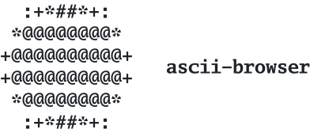

<p align="center">
  <picture>
    <source media="(prefers-color-scheme: dark)" srcset="docs/logo-dark.svg">
    
  </picture>
</p>

<p align="center">
  <b>The web in ninety-five characters.</b><br>
  A terminal browser that draws real pages in printable ASCII, one colour, one character per cell.
</p>

<p align="center">
  <a href="#install">Install</a> ·
  <a href="#use">Use</a> ·
  <a href="#keys">Keys</a> ·
  <a href="#flags">Flags</a> ·
  <a href="#renderers">Renderers</a> ·
  <a href="#known-limits">Known limits</a>
</p>

```
   The Mona Lisa[a] is a half-length portrait
   painting by the Italian artist Leonardo da                          Mona Lisa
   Vinci. Considered an archetypal masterpiece of         la Gioconda, Monna Lisa (Italian),
   the Italian Renaissance,[1][2] it has been                     la Joconde (French)
   described as "the best known, the most visited,     .--:-:-:--:---:--:--:--:--------:--:-:-.
   the most written about, the most sung about,        :++=++++=+++++++++++++++=+=++=++++=++++:
   [and] the most parodied work of art in the          :+========+=+===========+===+=+===+=+=+:
   world".[3] The painting's novel qualities           :==============+*##%%%%#+============+=:
   include the subject's enigmatic expression,[4]      :==----=--==-=+*+==+#%%%@#=======-=====:
   the monumentality of the composition, the subtle    :=-=---------+#=:::-+*#%@%%===--=---===:
   modelling of forms, and the atmospheric             -*+++====---=##==-=+++#%%@%#*+++=-=--=+:
   illusionism.[5]                                     -#**+**#*+++*%#=+-*=+++%@%@##**#*=-==++:
                                                       -#####*####%#%#===*--+#%@@%%%#***+++***-
   The painting has been traditionally considered      -%########%#%%%*=+**+*%%%@@%%#%%#%####%-
   to depict the Italian noblewoman Lisa del           -%%%##%#%####%%@#++*#%%%@%@%%########%%-
   Giocondo.[6] It is painted in oil on a white        -%%%####****#%%@%@*%%##%%@%%%###%#%##%#-
   poplar panel.[7] Leonardo never gave the            -%###*###%#%%@%%%#+=++=+#%%@%@%%##+*##%=
   painting to the Giocondo family.[8] It was          -%###*##%%%%%%%*-:-:---+##%%@%%#++***#%-
   believed to have been painted between 1503 and      -%#%#***##%%@#+-::::::-+####*##@%%*#***-
   1506; however, Leonardo may have continued          -###*#***%@%%+--::::::-+*##%%%@%@%@%%##-
   working on it as late as 1517. King Francis I of    -%#*#**%%@%%#%##**+++*#%%@%%%@%@@@%%%%%-
   France acquired the Mona Lisa after Leonardo's      -@#####@%@%%%%%###%##%%@%%%%##%%%@@@%%@-
   death in 1519, and it later became the property     -#****%%@%@%@%%@%%%%@@@%@%%%#%%@@%%@%%%-
   of the French Republic. It has normally been on     -%%##%%%%%@%@%@%@%%@%@%@@@%%@@%@@@@%@%@-
   display at the Louvre in Paris since 1797.[9]       -%%%@%%%%%%@%@%@%@%@%@@%@%@@%@%@%@%@%@%=
                                                       =%@%%%%%%%@%@%@@%@@@@%@@%@@@%@%@@@@%@%@-
   The painting's global fame and popularity partly    -@%@%#####*==++##%@%@@%@@%@%@%@%@%@@%@@-
   stem from its 1911 theft by Vincenzo Peruggia,      -@%%%%#%%##+======+#%%@%@%%@%@@@%@@@@@@-
   who attributed his actions to Italian patriotism    -@@@%@@%%%##**+++++**#*#####%%%@@@%@%@@-
   -a belief it should belong to Italy. The theft      -@%@%@%@@**+=*#*****#%#%%%%%%@%@%@@@@%@-
   and subsequent recovery in 1914 generated           -@%@%@%%%%#**#%%%%%%%%%@%@@@%@@@@@%@%@@-
   unprecedented publicity for an art theft, and       -@%@%@%@%@%#@%%@%%%@%@@%@@%@@@%@%@@@@@@-
   led to the publication of many cultural             -@%@%@%@%%@%@@%@@@@%@%@@%@@%@@@@@@%@%@@-
```

<p align="center"><sub><code>ascii-browser --once --size 100x60 https://en.wikipedia.org/wiki/Mona_Lisa</code>, rows 18 to 50</sub></p>

## What it is

`ascii-browser` drives a headless Chrome over the DevTools Protocol,
forces the page onto an 8x16 pixel grid and maps every cell to a
character by luminance, with the page text laid back on top as text.
Pictures become tone, text stays text, and videos play inside the page.
The dump is the point: a plain text file, one line per row, every line
exactly as wide as the grid, made only of the 95 printable characters
from `0x20` to `0x7E`.

The architecture follows [Browsh](https://www.brow.sh): a real browser
engine does the layout and the painting, and the terminal shows a text
rendering of what it painted. Here the engine is Chrome, driven from Go,
and the rendering is monochrome ASCII only.

## Install

Needs Go 1.26 or newer, which the pinned chromedp requires, and Google
Chrome or Chromium.

    go install github.com/eschero/ascii-browser/cmd/ascii-browser@latest

or from a clone:

    go build -trimpath -ldflags="-s -w" -o ascii-browser ./cmd/ascii-browser

## Use

Browse:

    ascii-browser https://en.wikipedia.org

One frame to a file, at a chosen resolution:

    ascii-browser --once --size 200x49 --dump page.txt https://en.wikipedia.org/wiki/Mona_Lisa

The page as an interface, with frames and widgets instead of tone:

    ascii-browser --renderer ui https://en.wikipedia.org/wiki/Mona_Lisa

A single picture, 800 columns wide, with its outlines drawn as lines:

    ascii-browser --image photo.jpg --size 800x0 --structure --dump photo.txt

## Keys

| Key | Action |
|---|---|
| `Up` / `Down` | scroll by a few rows |
| `PgUp` / `PgDn`, `Space` | scroll by a screen |
| `Shift+Up` / `Shift+Down` | scroll by half a screen |
| `Home` / `End` | top and bottom of the page |
| `Shift+Left` / `Shift+Right` | pan over a frame wider than the terminal |
| `Tab` / `Shift+Tab` | cycle links, buttons and fields |
| `Enter` | follow the link, press the button, focus the field |
| typing, in a field | goes to the page; `Esc` leaves the field |
| `Ctrl+L` | URL bar: `Enter` goes, `Esc` cancels |
| `Esc`, `Ctrl+[` | back |
| `Ctrl+]` | forward |
| `Ctrl+R` | reload |
| `Ctrl+D` | dump the current screen to the `--dump` file |
| `Ctrl+Q`, `Ctrl+C` | quit |

The mouse clicks, focuses and scrolls. While a video has the focus,
`Space` and `k` play and pause, `Left` / `Right` seek, `f` and `m` toggle
fullscreen and mute, `j`, `l` and `c` go to the player as well.

## Flags

<details>
<summary><b>Rendering</b></summary>

| Flag | Meaning |
|---|---|
| `--size COLSxROWS` | the grid, i.e. the resolution; 0 follows the terminal (80x24 with `--once`, the page height with `--full`) |
| `--zoom F` | graphics scale by F, text stays one character per cell (0.5..4, default 1) |
| `--ramp-preset P` | `standard` (10 levels), `short` (6, more contrast), `long` (70) |
| `--ramp "..."` | a free ramp, light to dark, printable ASCII only; overrides the preset |
| `--paper T` | luminance above which a cell is page background, blank with no error diffusion (default 0.93, 0 disables) |
| `--invert` | dense characters for bright pixels (phosphor) instead of dark ones (ink) |
| `--dark-pages M` | a page with a dark background, a dark theme: `invert` (default) draws it blank with the bright parts dense, `keep` maps it like any other |
| `--no-dither` | no Floyd-Steinberg dithering on the cell grid |
| `--structure` | cells with an oriented gradient become `/ \ \| - _`, the rest stays tonal |
| `--edge-threshold F` | with `--structure`: gradient strength above which a cell is an edge (0..1, default 0.12) |
| `--no-text` | graphics only, no page text |
| `--no-halo` | no blank cell before and after text over dark or textured areas |
| `--filler C` | character for runes with no ASCII transliteration (default `?`) |

</details>

<details>
<summary><b>Renderers and video</b></summary>

| Flag | Meaning |
|---|---|
| `--renderer R` | `auto` (default): text measured in the page up to four screens of frame height, read from a DOM snapshot above; `shot` and `snap` force one or the other; `ui` draws the page as an interface: frames, widgets, pictures inside their frames, no screenshot of the page |
| `--no-ui-media` | with `ui`: media as a placeholder instead of the picture |
| `--ui-media-min WxH` | with `ui`: media smaller than this many cells becomes a solid block (default 4x2) |
| `--ui-boxes` | with `--once --renderer ui`: list the interface boxes on stderr |
| `--video M` | `live` (default): every decoded frame, rendered inside the page; `poster`: one frame only; `off`: a placeholder |
| `--audio on\|off` | play sound through the system output, and let videos start with their sound (default on in the interactive browser, off with `--once`) |
| `--video-fps N` | cap on video frames per second; 0 (default) follows the video |

</details>

<details>
<summary><b>Output and modes</b></summary>

| Flag | Meaning |
|---|---|
| `--once` | render one frame, write the dump, exit |
| `--full` | with `--once`: the dump is as tall as the page |
| `--max-cells N` | with `--full`: cap on COLS*ROWS (default 4000000) |
| `--image URL-or-path` | render one image on a white full-width page, like `--once --full` |
| `--caption S` | with `--image`: text for a phone caption, `braille`, `ios` or `android` (see below) |
| `--caption-width N` | with `--caption`: characters per line (default: what fits on one line of a phone) |
| `--dump FILE` | file written by `--once` and `Ctrl+D` (stdout when empty) |
| `--links` | with `--once`: list links and fields in Tab order on stderr |
| `--buffer N` | interactive: frame buffer of N screens; scrolling inside it needs no capture (default 3) |

</details>

<details>
<summary><b>Loading the page</b></summary>

| Flag | Meaning |
|---|---|
| `--cookies M` | answer cookie and consent banners: `reject` (default: the refusal, or the acceptance where refusing means paying or there is no refusal), `accept`, or `off` to leave them |
| `--profile DIR` | where Chrome keeps its profile, so cookies, consents and logins survive; empty for a throwaway one (default: one directory per user under the config folder) |
| `--timeout D` | navigation timeout (default 10s) |
| `--dom-quiet D` | wait for the page to stop rebuilding itself for this long before reading it (default 300ms, 0 to skip) |
| `--wake on\|off` | scroll through the whole page once after loading so lazy images and scroll-revealed blocks appear (default on with `--once` and `--full`, off in the interactive browser) |
| `--strict-opacity` | treat an element at opacity 0 as hidden even while it is animating that opacity |
| `--dom-text` | read text from the DOM even where the page paints nothing: opacity is ignored, display, visibility and clipping still apply |

</details>

<details>
<summary><b>Chrome and diagnostics</b></summary>

| Flag | Meaning |
|---|---|
| `--chrome PATH` | the Chrome or Chromium binary (default: autodetect) |
| `--show` | run Chrome with a visible window |
| `--shot-format F` | screenshot encoding: `png`, `jpeg`, or `auto` (png up to 4M pixels, jpeg above) |
| `--timing` | timings to stderr |
| `--log FILE` | append timings and notes to a file; interactive mode logs frames and inputs too |

</details>

## Renderers

The default renderer maps the page's pixels onto a character ramp and lays
the page text on top. `--renderer ui` draws the page as an interface
instead: containers with a border or a background of their own become
ASCII frames, form controls become terminal widgets, headings get an
underline and list items a marker. Pictures keep their pixels: every
image, video, canvas and frame is rendered as ASCII inside its own frame
through the usual tonal pipeline, so `--ramp`, `--paper`, `--invert` and
`--structure` all apply within the picture. One that cannot be
photographed falls back to a framed `[ IMG alt text ]`, and `--no-ui-media`
asks for that everywhere. An opaque background hides what is under it: a
dropdown, a modal or a cookie banner blanks the page beneath, while a
translucent one lets it show through.

A playing video is rendered inside the page, once per decoded frame, and
only its own cells are redrawn: a 1080p video plays at the speed it
decodes, around 59 frames a second, with its sound in the interactive
browser, without the rest of the page being read again, and whatever the
page paints over the video, a caption, the menu, a panel, stays on top.
Clicking a video plays or pauses it.

Design notes, with the measurements behind each decision, are in
[`docs/design.md`](docs/design.md).

## Pictures for a caption

    ascii-browser --image photo.jpg --caption braille > caption.txt

A caption on a phone is set in a proportional system font, where ordinary
ASCII art falls apart, and runs of spaces are dropped. `--caption braille`
draws with braille patterns, 2x4 dots per character and the same width in
every system font, the most faithful but not ASCII. `--caption ios` and
`--caption android` stay plain ASCII, using only the characters that share
one width in Apple's system font or in Roboto, light to dark, without the
space, `#` or `@`: aligned, but with less tonal range, and only on that
platform. The width defaults to what fits on one line of a phone, and the
text is kept within Instagram's 2200 characters; `--caption-width` and
`--invert` adjust it.

## Examples

Four dumps in [`examples/`](examples), produced by:

    ascii-browser --once --size 200x49 --dump examples/example-com-200x49.txt https://example.com
    ascii-browser --once --size 200x49 --dump examples/mona-lisa-200x49.txt https://en.wikipedia.org/wiki/Mona_Lisa
    ascii-browser --once --size 200x49 --renderer ui --dump examples/mona-lisa-200x49-ui.txt https://en.wikipedia.org/wiki/Mona_Lisa
    ascii-browser --image "https://upload.wikimedia.org/wikipedia/commons/e/e0/Creaci%C3%B3n_de_Ad%C3%A1n.jpg" --size 800x0 --structure --dump examples/creazione-di-adamo-800-structure.txt

The two Mona Lisa dumps are the same screen through the two renderers:
the tonal one maps every cell of the page to a character, the interface
one draws frames and widgets and renders only the pictures tonally, inside
their frames. The last one is 800 columns wide with `--structure`: the
outlines of the two figures and of the arms read as lines, the modelling
of the bodies stays tonal. Open the files in a monospace editor and zoom
out.

## Known limits

- **Reveals that never fire.** Some pages keep blocks at `opacity: 0`
  until an animation reveals them, and some of those animations never
  start in a headless browser, whatever is done to the page. Such blocks
  are rendered as the page paints them: not at all. `--dom-text` reads
  their text from the DOM anyway, at the price of also showing what the
  page hides on purpose.
- **Cross-origin video at 8 frames a second.** A video from another
  origin without CORS headers cannot be read inside the page, so Chrome
  photographs its box instead, at most eight times a second. Same-origin
  video plays at its own rate.
- **Bot checks.** Chrome presents itself as plain Chrome, not
  HeadlessChrome, which gets past most checks. A few services still
  answer with a verification page and nothing else (DataDome on
  NYTimes, Reuters, TripAdvisor and Pinterest, a proof-of-work page on
  gnu.org). `--show` runs Chrome with a visible window, which usually
  passes, and `--profile` keeps the result.
- **Consent banners** are answered by matching the button labels in
  Italian, English, German, French, Spanish and Dutch, inside the page,
  its shadow trees and the consent manager's own iframe. A banner worded
  otherwise stays, and `--cookies off` leaves them all alone.
- **Sound follows the page.** With `--audio on` a video plays with its
  own sound when the page starts it, and `m` mutes it while it has the
  focus; a video the page leaves paused stays paused until clicked.
- **One Chrome per profile.** A second session finding the profile in
  use falls back to a throwaway one and keeps nothing.
- **Scroll-driven sequences.** Some pages advance an animation from
  the scroll progress through a section, computed by a script from the
  viewport height. With the interactive buffer several screens tall the
  arithmetic is off, and on some of them the value never moves at all
  in a headless browser, so the frames of the sequence never appear. The
  same tall viewport makes anything sized in `vh` three times as tall as
  in a normal window.
- **Fixed elements inside the buffer.** A fixed header or footer sits at
  the top or bottom of Chrome's viewport, which in the interactive
  browser is the frame buffer, several screens tall. It is therefore drawn
  where the buffer starts, and shows only when the view is there.
- **What is measured is what Chrome lays out** with every glyph forced
  to one 8x16 cell: proportional text takes more room than in a normal
  browser, and pages built around exact pixel widths can wrap differently.

## Credits

The architecture follows [Browsh](https://www.brow.sh). The logo is a
black disk rendered by `ascii-browser --image --size 12x0 --no-dither`,
set in Go Mono Bold.

## License

LGPL 2.1, see [`LICENSE`](LICENSE).
